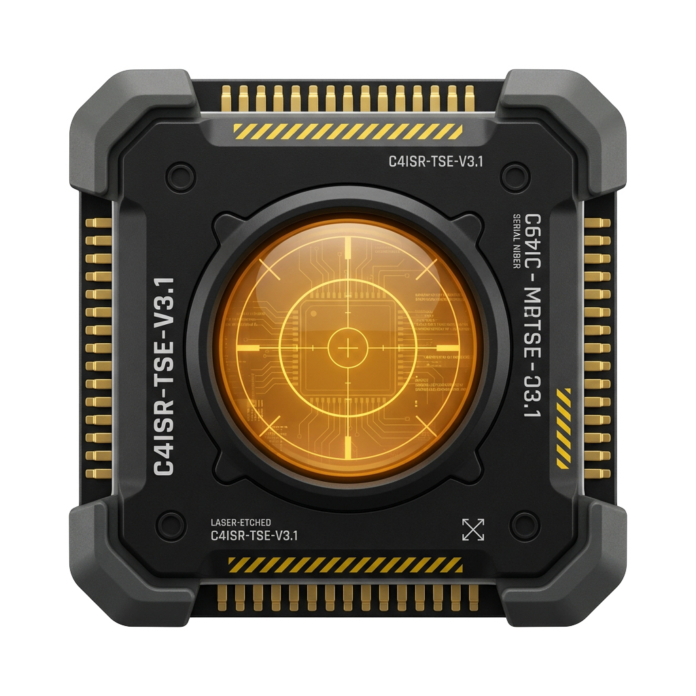

# Arma 3 SQF Review Plugin

<p align="center">
  
</p>

<p align="center">
  <strong>Equipo de agentes de IA y arnés determinista para desarrollo, auditoría de localidad multijugador, rendimiento y mejores prácticas en scripts SQF de Arma 3.</strong>
</p>

<p align="center">
  
  
  
  
</p>

---

## 🎯 Descripción General

`arma3-sqf-review` es un plugin avanzado para el entorno **Antigravity** diseñado específicamente para creadores de misiones y desarrolladores de mods/addons en **Arma 3**.

Desarrollar para Arma 3 en servidores dedicados (`Arma3Server`) presenta desafíos técnicos únicos: localidad de argumentos y efectos (`AL`/`AG`/`EL`/`EG`), jugadores que se unen en progreso (`JIP`), suspensión en contextos no programados (*unscheduled*), orden de inicialización y sincronización de red vía `remoteExec` y `publicVariable`. 

Este plugin implementa un **equipo colegiado de 11 subagentes especializados** guiados por un motor determinista en Python, asegurando que el código producido o auditado sea robusto, eficiente, respetuoso del scheduler y libre de fugas de variables o bloqueos de inicialización.

---

## 🏛️ Arquitectura de Ejecución

El plugin opera bajo el principio **"El script es la puerta, la prosa es el flujo"**:
- **La prosa (`SKILL.md`)** gobierna el flujo conversacional y el ciclo de corrección entre subagentes (máximo 3 iteraciones).
- **El script Python (`sqf_orchestrator.py`)** actúa como puerta de calidad determinista e inmutable: clasifica modos de proyecto, normaliza severidades del linter y aborta formalmente si persisten defectos bloqueantes tras 3 ciclos (Puerta de Calidad T09).

```
                               ┌─────────────────────────────┐
                               │   Usuario / Orquestador     │
                               └──────────────┬──────────────┘
                                              │ Triage (--mode-query)
                     ┌────────────────────────┴────────────────────────┐
                     ▼                                                 ▼
             Modo Micro (1 archivo)                         Modos Estándar / Completo
                     │                                                 │
        ┌────────────┴────────────┐                    ┌───────────────┴───────────────┐
        ▼                         ▼                    ▼               ▼               ▼
sqf-static-analyzer      sqf-best-practices      sqf-architect   sqf-developer   sqf-locality
   (run_sqflint)              reviewer               (diseño)      (por módulo)      auditor
        │                         │                    │               │               │
        └────────────┬────────────┘                    └───────────────┼───────────────┘
                     │                                                 │
                     ▼                                                 ▼
        ┌─────────────────────────┐                    ┌───────────────────────────────┐
        │   Ciclo de Corrección   │                    │   Oleada de Revisión + Gate   │
        │   (Máximo 3 pasadas)    │                    │  (Locality + Perf + Syntax)   │
        └────────────┬────────────┘                    └───────────────┬───────────────┘
                     │                                                 │
                     └────────────────────────┬────────────────────────┘
                                              ▼
                                 Puerta de Calidad Final
                             (Informe estructurado PASA / NO)
```

---

## 🤖 El Equipo de Subagentes (11 Especialistas)

| Agente | Rol | Responsabilidad | Tier |
|---|---|---|---|
| `sqf-architect` | Arquitectura | Contrato de interfaces públicas, mapa de máquinas (servidor/cliente/HC) y configuración de `CfgRemoteExec`. | `pro` |
| `sqf-developer` | Desarrollador | Implementación estricta de módulos SQF según el contrato, con archivos disjuntos. | `pro` |
| `sqf-locality-auditor` | Red y Locality | Invariantes de servidor dedicado, flags `remoteExec`, persistencia JIP, compatibilidad Headless Client y prevención de softlocks. | `pro` |
| `sqf-innovator` | Innovación | Propone mecánicas viables aplicando filtros de ancho de banda, presupuesto por frame y persistencia. | `pro` |
| `sqf-static-analyzer` | Análisis Estático | Ejecución determinista de `sqflint` vía envoltorio normalizador. | `flash` |
| `sqf-best-practices-reviewer` | Buenas Prácticas | Evaluación perezosa, scope local (`private`), nomenclatura y micro-optimizaciones. | `flash` |
| `sqf-performance-auditor` | Rendimiento | Carga del scheduler, optimización de bucles por frame (PFH vs EachFrame), escaneos globales y plan de medición. | `flash` |
| `sqf-mission-config-auditor` | Configuración | Extracción y validación de hechos de `description.ext` o `config.cpp`, `CfgPatches` y whitelists. | `flash` |
| `sqf-claim-verifier` | Verificación Wiki | Comprobación estricta de comandos contra la base de datos oficial BIKI (`a3ref`) y extracción de SHA en runtime. | `flash` |
| `sqf-test-plan-generator` | Plan de Pruebas | Generación de planes de prueba manuales específicos para servidor dedicado y clientes tardíos (JIP). | `flash` |
| `sqf-doc-writer` | Documentación | Redacción de guías de uso completas del sistema implementado (instalación, API y multijugador). | `flash` |

---

## 🚦 Modos de Operación

El modo de revisión se determina determinísticamente mediante el análisis del inventario de código:

1. **Micro**:
   - **Criterio**: Exactamente 1 archivo `.sqf`, $\le 50$ líneas, sin archivos de ciclo de vida (`init*.sqf`, `description.ext`) ni primitivas de red.
   - **Flujo**: Rápido (1–2 agentes), análisis estático con `sqflint`, verificación de invariantes de servidor dedicado y entrega sin burocracia.
2. **Estándar**:
   - **Criterio**: 2 a 3 archivos, o $> 50$ líneas, o presencia de primitivas de red (`remoteExec`, `publicVariable`).
   - **Flujo**: Auditoría de red, análisis de rendimiento, revisión semántica y plan de pruebas.
3. **Completo**:
   - **Criterio**: $\ge 4$ archivos, $\ge 3$ módulos, JIP, Headless Client, persistencia o encargo explícito de auditoría integral.
   - **Flujo**: Ciclo completo con diseño de interfaces (`sqf-architect`), desarrollo modular en paralelo y suite documental.

---

## 🛠️ Herramientas de Línea de Comandos (CLI)

El plugin incluye utilidades CLI deterministas ejecutables de forma independiente:

### 1. Consulta Determinista de Modo (`--mode-query`)
Calcula el modo de revisión analizando los archivos del proyecto:
```bash
python skills/arma3-sqf-review/scripts/sqf_orchestrator.py --root <raíz_del_proyecto> --mode-query
```

### 2. Análisis Estático con Severidades Normalizadas (`--lint`)
Ejecuta el análisis estático unificado (eleva advertencias de fugas de scope a `BLOQUEANTE`):
```bash
python skills/arma3-sqf-review/scripts/sqf_orchestrator.py --root <raíz_del_proyecto> --lint
```
*(o sobre un archivo específico: `python skills/arma3-sqf-review/scripts/sqf_orchestrator.py <archivo.sqf> --lint`)*

### 3. Modo Forzado (`--mode`)
Permite fijar un modo explícito desactivando el re-escalado automático:
```bash
python skills/arma3-sqf-review/scripts/sqf_orchestrator.py --root <raíz> --mode Micro --lint
```

---

## 📦 Instalación y Requisitos

### Requisitos Previos
- **Python**: 3.11 o superior.
- **Antigravity** o **Gemini CLI**.
- *(Opcional pero muy recomendado)* **`sqflint`**: Linter nativo de SQF. Puede instalarse vía binario o mediante `cargo install sqflint`.

### Instalación en Antigravity
Clona o copia el repositorio dentro del directorio de plugins de Antigravity:

```bash
git clone https://github.com/usuario/arma3-sqf-review.git ~/.gemini/config/plugins/arma3-sqf-review
```

### Configuración de la Réplica Offline BIKI (Opcional)
Para validar comandos y funciones offline con exactitud criptográfica, el plugin puede conectarse a un catálogo `a3ref`:
```bash
# Definir variable de entorno opcional:
export A3REF_WIKI_PATH="/ruta/hacia/a3ref/data"
```
*Si la réplica no está presente, el plugin busca rutas relativas por defecto o degrada limpiamente indicando `NO VERIFICADO` con honestidad técnica.*

---

## 🧪 Arnés de Pruebas

El repositorio cuenta con una suite integral de 48 pruebas unitarias y de integración que validan escalados, análisis de scope, fallbacks y el bucle de calidad T09:

```bash
python -m pytest tests/ -v
```

---

## 📄 Licencia

Este proyecto está distribuido bajo los términos de la Licencia **MIT**. Consulta el archivo [LICENSE](LICENSE) para más detalles.
